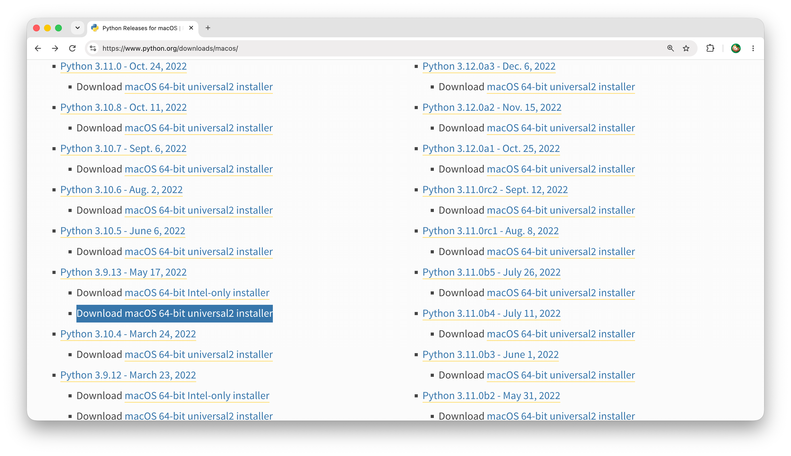

[English]({{ "/" | relative_url }}) | **한국어** | [日本語]({{ "/jp.html" | relative_url }})

<p class="article-byline">K. Ford · 마지막 업데이트: 2025년 11월</p>

# 내 음악 파일에서 각각의 악기와 보컬 소리 추출하기

**HTDemucs 6-Stem 체크포인트를 Core ML FP16 모델로 변환하고 내 음악 파일에 적용해보기**

**예상 시간:** 20분 내외  
**최종 결과:** macOS 13 이상에서 사용 가능한 음원 분리용 Core ML 패키지 `HTDemucs_CoreML_FP16.mlpackage`

보컬, 드럼, 베이스, 기타, 피아노 등 여러 소리가 믹싱된 음원에서 각 악기의 소리를 다시 분리해 낼 수 있을까?

AI 연구자 **Alexandre Défossez와 공동 연구자들** 은 이 문제를 해결하기 위해 **Demucs**라는 인공지능 음원 분리 모델을 개발했습니다. 연구진은 **MUSDB HQ 등 음악 데이터**를 활용해 모델을 학습시켰고, 다른 사람들이 후속 연구에 사용할 수 있도록 일부 코드와 사전 학습된 모델의 체크포인트를 공개했습니다. 나중에 등장한 **Hybrid Transformer Demucs (HTDemucs)** 는 파형과 스펙트로그램을 함께 처리하여 여섯개의 Stem (드럼, 베이스, 보컬, 기타, 피아노, 그밖의 소리들) 을 깔끔하게 분리하는데 성공합니다.

이 튜토리얼은 체크포인트를 직접 다운로드하고, Mac에서 Core ML 형식으로 변환한 다음, 마지막에 테스트 음원으로부터 여섯개 Stem을 분리해내고 직접 들어보는 과정을 다룹니다.

<figure style="margin: 24px 0; text-align: center;">
  
  <figcaption style="margin-top: 8px; font-size: 14px; color: #666;">
    사진 소스 -
    <a href="https://www.pexels.com/@wahlex-1869682520/" target="_blank" rel="noopener noreferrer">Wahlex</a>,
    pexels.com
  </figcaption>
</figure>

## 목차

- [무엇을 만들게 되나?](#무엇을-만들게-되나)
- [준비](#준비)
- [1단계. 터미널 열고 작업 폴더 만들기](#1단계-터미널-열고-작업-폴더-만들기)
- [2단계. 체크포인트 다운로드하기](#2단계-체크포인트-다운로드하기)
- [3단계. 변환기 ZIP 파일 다운로드하기](#3단계-변환기-zip-파일-다운로드하기)
- [4단계. Core ML 변환기 압축 풀기](#4단계-core-ml-변환기-압축-풀기)
- [5단계. Python 설치하고 전용 작업 공간 만들기](#5단계-python-설치하고-전용-작업-공간-만들기)
- [6단계. 다운로드한 체크포인트를 PyTorch 캐시에 넣기](#6단계-다운로드한-체크포인트를-pytorch-캐시에-넣기)
- [7단계. 변환용 코드 약간 수정하기](#7단계-변환용-코드-약간-수정하기)
- [8단계. FP16 Core ML 모델 만들기](#8단계-fp16-core-ml-모델-만들기)
- [9단계. 모델 입력과 출력 확인하기](#9단계-모델-입력과-출력-확인하기)
- [10단계. 직접 분리해 보고 들어보기](#10단계-직접-분리해-보고-들어보기)
- [문제 해결 FAQ](#문제-해결-faq)
- [마치며](#마치며)
- [참고 자료와 출처](#참고-자료와-출처)

## 무엇을 만들게 되나?

**HTDemucs_CoreML_FP16.mlpackage** 라는 Core ML 인공지능 모델 패키지를 만듭니다. 이 모델은 44.1 kHz 스테레오 오디오를 10초 단위로 입력받아 드럼, 베이스, 보컬, 기타, 피아노, 그밖의 소리들로 분리합니다. 마지막 실습에서는 제공된 test_10s.wav를 입력해 여섯 개의 WAV 파일을 만들고 직접 들어봅니다. 이 모델을 적절히 활용하면 10초보다 긴 음악 파일도 여러 구간으로 나누어 처리한 뒤 다시 하나로 합쳐 연속된 Stem 파일들을 만들수도 있습니다.

<div style="background:#fff5e6; border-left:4px solid #b86119; border-radius:8px; padding:18px 22px; margin:20px 0 24px;">
  <div style="color:#a45316; font-size:17px; font-weight:700; margin-bottom:8px;">
    스템 분리 모델을 만들었다면!
  </div>
  <div style="color:#553c25; line-height:1.7;">
    생성된
    <strong><code>HTDemucs_CoreML_FP16.mlpackage</code></strong>
    모델은
    <strong>개인 음악 연습, 애플리케이션 개발, 연구 등 다양한 용도로 활용할 수 있습니다.</strong>
  </div>
</div>

음악 연습 앱이 사용자 제공 Core ML 모델을 지원한다면, 이 모델을 불러와 곡을 드럼, 베이스, 보컬, 기타, 피아노, 그 외 사운드의 6개 스템(Stem)으로 분리할 수 있습니다. 특정 악기를 분리하거나 제거하여 개인 연습용 반주 트랙을 만들 수도 있습니다.

개발자와 연구자는 이 모델을 자체 애플리케이션, 오디오 처리 워크플로(Workflow), 연구 프로젝트에 통합할 수도 있습니다.

**호환성 참고:** 애플리케이션은 모델의 입력 및 출력 규격, 즉 스템 순서(드럼, 베이스, 보컬, 기타, 피아노, 기타 사운드), 출력 형식(Output Format), 텐서 차원(Tensor Dimensions) 호환성을 고려해야 합니다.

## 준비

- **macOS 13 이상이 설치된 Mac** (Apple Silicon 및 Intel 모두 지원)
- **인터넷 연결**
- **터미널(Terminal) 앱** (Mac에 기본 설치된 앱)
- **웹 브라우저** (체크포인트 다운로드 등에 필요)
- **실습용 음원 `test_10s.wav`** (이 튜토리얼에서 제공 - [`test_10s.wav`](resources/test_10s.wav))

---

## 1단계. 터미널 열고 작업 폴더 만들기

### 1-1. 터미널이란?

**터미널(Terminal)** 은 Mac에 글자로 명령을 내리는 창구 역할을 하는 앱입니다. 마우스로 폴더를 만들고 이동하는 대신, 짧은 명령어를 타이핑해 넣어 컴퓨터에게 일을 지시할 수 있습니다.

_ 표시">

터미널을 여는 방법:

1. Finder를 엽니다.
2. **응용 프로그램(Applications)** → **유틸리티(Utilities)** 폴더로 이동합니다.
3. 위 그림과 같은 **터미널(Terminal)** 앱을 더블클릭합니다.

또는 `⌘ Command + Space`를 눌러 `Terminal`을 검색하고 Return을 눌러도 됩니다.

터미널을 열면 다음과 비슷한 **프롬프트(prompt)** 가 보입니다. `~`는 Mac 사용자의 홈 폴더를 뜻합니다. 프롬프트가 **현재 작업 위치는 당신의 홈 폴더입니다** 라고 표시해주고 있습니다.

<pre class="no-copy"><code>사용자이름@Mac이름 ~ %</code></pre>

프롬프트 끝에 작업 지시 명령을 입력할 수 있습니다.

### 1-2. 작업 폴더 만들기

다음 네 개의 명령어를 모두 복사하여 터미널에 붙여넣고 Return(Enter) 키를 누르세요. 명령어는 순서대로 실행됩니다.

```bash
mkdir -p ~/htdemucs
cd ~/htdemucs
pwd
ls
```

각 명령어의 역할은 다음과 같습니다.

1. `mkdir -p ~/htdemucs` - 홈 폴더에 `htdemucs` 폴더가 없으면 새로 만듭니다.
2. `cd ~/htdemucs` - `htdemucs` 폴더로 이동합니다.
3. `pwd` - 현재 폴더의 경로를 표시합니다.
4. `ls` - 현재 폴더 안의 파일 목록을 표시합니다.

**확인:** `pwd` 명령으로 표시된 경로가 `/htdemucs`로 끝나면 성공입니다. 폴더가 비어 있다면 `ls` 명령을 실행해도 아무것도 표시되지 않습니다. 이는 정상입니다.

---

## 2단계. 체크포인트 다운로드하기

**체크포인트(checkpoint)** 란 인공지능 모델이 학습을 통해 얻은 가중치들을 저장한 파일입니다. 인공지능 모델의 본체라고 할 수 있는 중요한 파일로, 이를 이용하면 방대한 데이터를 수집하고 모델을 직접 학습시키는 과정을 건너뛰고 이미 학습된 모델을 사용할 수 있습니다.

다운로드할 파일 이름은 `5c90dfd2-34c22ccb.th` 입니다. 아래 링크 중 하나를 열어 체크포인트 파일을 다운로드하세요.

- **Meta 서버:** [5c90dfd2-34c22ccb.th 다운로드](https://dl.fbaipublicfiles.com/demucs/hybrid_transformer/5c90dfd2-34c22ccb.th)
- **Hugging Face — lainlives/audio-separator-models:** [파일 페이지](https://huggingface.co/lainlives/audio-separator-models/blob/main/5c90dfd2-34c22ccb.th)
- **Hugging Face — lainlives/audio-separator-models-old:** [파일 페이지](https://huggingface.co/lainlives/audio-separator-models-old/blob/a78be39e563e8337bc7f2e5241d8063256d86167/5c90dfd2-34c22ccb.th)

Finder에서 `Downloads` 폴더를 열고 `5c90dfd2-34c22ccb.th` 파일이 받아졌는지 확인하세요. 다음 단계에서는 `~/Downloads/5c90dfd2-34c22ccb.th`에 있다고 가정합니다.

---

## 3단계. 변환기 ZIP 파일 다운로드하기

변환기(Converter)는 사전 훈련된 HTDemucs PyTorch 모델을 macOS에서 실행할 수 있는 Core ML 모델로 변환하는 도구입니다.

이 튜토리얼에서 사용하는 버전을 다운로드합니다.

**[HTDemucs Core ML 변환기 다운로드 (커밋 d6fe735)](https://github.com/dexxdean/htdemucs-coreml/archive/d6fe735.zip)**

호환성을 유지하기 위해 **`d6fe735`** 커밋 버전을 사용합니다.

Finder에서 **`Downloads`** 폴더를 엽니다. 다운로드된 파일 이름은 다음과 비슷합니다.

`htdemucs-coreml-d6fe735f2c485f88cce9db123f4bacc3a9d3f02a.zip`

파일 이름을 **`htdemucs-coreml.zip`**으로 변경합니다.

---

## 4단계. Core ML 변환기 압축 풀기

이 변환기는 원래 4-stem용으로 구성되어 있습니다. 이후 단계에서 6-stem을 지원하도록 수정하겠습니다.

아래 명령어를 모두 복사하여 터미널에 붙여넣고 Return(Enter) 키를 누르세요. ZIP 파일의 압축을 **`~/htdemucs/htdemucs-coreml`** 폴더에 풀고 필요한 파일이 있는지 확인합니다.

```bash
cd ~/htdemucs
unzip -q ~/Downloads/htdemucs-coreml.zip -d converter-download
mv converter-download/* htdemucs-coreml
rmdir converter-download
cd htdemucs-coreml
ls convert.py requirements.txt
```

다음과 같이 출력되면 성공입니다.

<pre class="no-copy"><code>convert.py       requirements.txt</code></pre>

---

## 5단계. Python 설치하고 전용 작업 공간 만들기

**Python(파이썬)** 은 우리가 사용할 변환 프로그램을 실행하는 언어입니다. 버전 3.9를 이용하겠습니다.

### 5-1. Python 설치 여부 확인하기

터미널에 다음 명령을 입력합니다.

```
python3.9 --version
```

`Python 3.9.x`가 나오면 5-2로 넘어갑니다. `command not found` 같은 메시지가 나오면 [Python 공식 사이트](https://www.python.org/downloads/macos/)에서 Python 3.9용 macOS 설치 프로그램을 다운로드하여 설치하세요. Intel Mac과 Apple Silicon Mac 모두 지원하는 설치 프로그램을 선택합니다.

<figure style="margin: 24px 0; text-align: center;">
  
  <figcaption style="margin-top: 8px; font-size: 14px; color: #666;">
    Python 3.9.x macOS 64-bit universal2 installer 를
    <a href="https://www.python.org/downloads/macos/" target="_blank" rel="noopener noreferrer">공식 파이썬 웹사이트</a> 에서 다룬로드받아 설치합니다.
  </figcaption>
</figure>

확인을 위해 설치 후 터미널에서 위의 명령을 다시 실행해 봅니다.

### 5-2. 작업 공간 만들기

이 튜토리얼에서는 몇가지 Python용 패키지를 설치하는 과정이 포함되어있습니다. **가상환경(virtual environment)** 이라고 부르는 독립된 작업 공간을 만들어서 다른 프로젝트의 Python 패키지들과 섞이지 않게 해 줍니다.

우선 `~/htdemucs/htdemucs-coreml` 로 이동한 뒤 가상환경을 만들고 사용하도록 설정합니다.

```
cd ~/htdemucs/htdemucs-coreml
python3.9 -m venv .venv
source .venv/bin/activate
```

이 명령들을 실행하고 나서부터 터미널 프롬프트 앞에 `(.venv)`가 나타나면 성공입니다. 이것은 **이번 작업용 Python 가상환경이 활성화되었다는 표시** 입니다.

<pre class="no-copy"><code>(.venv) 사용자이름@Mac이름 ~/htdemucs/htdemucs-coreml %</code></pre>

`(.venv)` 옆에 `(base)` 가 보여도 상관 없습니다.

### 5-3. 필요한 Python 패키지 설치하기

이제 변환 프로그램이 필요로 하는 패키지들을 설치합니다. 복사해서 프롬프트에 붙여넣고 제출하세요.

```
python -m pip install --upgrade pip
python -m pip install -r requirements.txt
python -m pip install "numpy==2.0.2" scipy
python -m pip check
```

첫 번째 명령은 Python 패키지 설치 도구인 `pip`를 업데이트합니다. 두 번째는 변환기에 필요한 패키지들을 설치하고, 세 번째는 `NumPy 2.0.2`와 마지막 음원 분리 실습에 필요한 `scipy`를 설치합니다. 마지막 명령은 설치된 패키지들 사이에 의존성 충돌이 있는지 확인합니다. 설치에는 시간이 걸릴 수 있습니다.

`requirements.txt`에도 `NumPy`가 포함되어 있지만, 이 튜토리얼에서는 버전을 2.0.2로 고정하기 위해 별도로 설치합니다.

완료되면 아래 명령으로 확인합니다.

```
python -c 'import torch, demucs, coremltools, numpy, einops; print("Python packages: OK")'
```

`Python packages: OK`가 출력되면 필요한 패키지를 모두 정상적으로 설치했다는 의미입니다. 오류가 나오면 아래 **문제 해결 FAQ**를 확인하세요.

**작업중에 터미널을 닫고 새 터미널에서 다시 시작한다면?** 처음부터 설치할 필요는 없습니다. 터미널을 열고 아래 두 명령을 먼저 수행한 뒤에 작업을 이어가면 됩니다.

```
cd ~/htdemucs/htdemucs-coreml
source .venv/bin/activate
```

---

## 6단계. 다운로드한 체크포인트를 PyTorch 캐시에 넣기

터미널에 아래 명령을 통째로 붙여넣고 Return을 누릅니다. 2단계에서 다운로드한 체크포인트 파일(`5c90dfd2-34c22ccb.th`)을 캐시 경로로 자동 복사합니다.

```
python - <<'PY'
from pathlib import Path
import shutil
import torch

source = Path.home() / 'Downloads' / '5c90dfd2-34c22ccb.th'
target_dir = Path(torch.hub.get_dir()) / 'checkpoints'
if not source.is_file():
    raise SystemExit(f'ERROR: checkpoint not found: {source}')
target_dir.mkdir(parents=True, exist_ok=True)
target = target_dir / source.name
shutil.copy2(source, target)
print('Copied checkpoint to:', target)
PY
```

실행 후 마지막 줄에 `Copied checkpoint to:`와 경로가 출력되면 성공입니다.

---

## 7단계. 변환용 코드 약간 수정하기

이 가이드에서 가장 중요한 부분입니다. 우리가 다운로드했던 변환기(변환용 코드)는 4-stem용 기본값을 사용합니다. 이를 아래와 같이 바꾸어야 합니다. 이때 Core ML 최소 실행 버전도 macOS 13으로 설정합니다. 이는 여러분이 만든 모델을 비교적 오래된 macOS에서도 사용할 수 있도록 하기 위한 것입니다.

| 항목            | 원래 값                    | 변경 값                                   |
| --------------- | -------------------------- | ----------------------------------------- |
| 모델 이름       | `htdemucs`                 | `htdemucs_6s`                             |
| stem 개수       | `4`                        | `6`                                       |
| 출력 재배열     | `[3, 0, 1, 2]`             | `[0, 1, 3, 4, 5, 2]`                      |
| 출력 이름       | vocals, drums, bass, other | drums, bass, vocals, guitar, piano, other |
| 출력 설명 크기  | `(1, 4, 2, …)`             | `(1, 6, 2, …)`                            |
| 최소 macOS 버전 | `macOS14`                  | `macOS13`                                 |

원래 Demucs 6-source 모델의 내부 출력 순서는 **drums, bass, other, vocals, guitar, piano**입니다. 이 가이드는 출력 순서를 **drums, bass, vocals, guitar, piano, other**로 변경하겠습니다.

### 7-1. 보조 스크립트 다운로드

이 튜토리얼과 함께 제공되는 [`prepare_six_stem.py`](resources/prepare_six_stem.py) 파일을 다운로드하세요. `~/Downloads` 폴더에 저장했다고 가정합니다.

다음 명령들을 한줄씩 실행합니다.

```
cd ~/htdemucs/htdemucs-coreml
cp ~/Downloads/prepare_six_stem.py .
ls convert.py prepare_six_stem.py
```

첫 번째 줄의 명령은 혹시 작업중에 다른 폴더로 이동했을 수 도 있기때문에 안전을 위해 실행하는것이니 생략해도 좋습니다.
`cp`명령어로 파일을 현재 위치한 폴더로 복사한 다음, `ls`명령어로 복사가 되었나 확인합니다. 두 파일이 보이면 수정 코드를 실행합니다.

```
python prepare_six_stem.py
```

이 스크립트는 `convert.py`를 `convert.py.original-4stem`으로 백업하고, `convert.py`의 내용을 몇군데 변경합니다. 변경 중에 오류가 발생하면 자세한 내용을 출력하도록 설계했습니다.

> 보조 스크립트가 원본 코드 속에서 변경할 부분을 찾지 못하면 수정을 중단합니다. 그 경우 아래 FAQ를 확인하세요.

**예상 결과:**

<pre class="no-copy"><code>SUCCESS: convert.py adapted for six stems.
Backup: convert.py.original-4stem
Model: htdemucs_6s
Output: drums, bass, vocals, guitar, piano, other</code></pre>

### 7-2. 수정 결과 확인

통째로 터미널 프롬프트에 복사해서 붙여넣고 Return키를 누르세요.

```
python -m py_compile convert.py
python - <<'PY'
from pathlib import Path
s = Path('convert.py').read_text()
for line in s.splitlines():
    if line.startswith(('MODEL_NAME =', 'NUM_SOURCES =', 'SOURCE_REORDER =', 'SOURCE_NAMES =')):
        print(line)
PY
```

다음과 같이 결과가 출력되면 정상입니다.

<pre class="no-copy"><code>MODEL_NAME = "htdemucs_6s"
NUM_SOURCES = 6
SOURCE_REORDER = [0, 1, 3, 4, 5, 2]
SOURCE_NAMES = ["drums", "bass", "vocals", "guitar", "piano", "other"]</code></pre>

### 왜 변환기를 직접 수정하나?

원래 HTDemucs의 일부 연산은 `coremltools`가 그대로 변환하기 어렵습니다. 공개 변환기는 복소수 연산을 실수 기반 표현으로 처리하고, attention 연산 및 overlap-add 경로를 변환 가능한 형태로 구현합니다. **가중치는 새로 학습하지 않으며**, 네트워크 모델을 Core ML 형식으로 옮기는 것이 목적입니다.

---

## 8단계. FP16 Core ML 모델 만들기

**Core ML 패키지** 를 만드는 최종 단계입니다.

현재 터미널의 작업 위치를 `htdemucs-coreml` 폴더로 옮긴 뒤 변환기 `convert.py`를 실행합니다. 프롬프트 맨 앞에 `(.venv)`가 붙어있어야 합니다.

```
cd ~/htdemucs/htdemucs-coreml
python convert.py --fp16 --compute-units cpu_and_gpu
```

변환기 실행 중 화면에는 다음 단계가 표시됩니다.

<pre class="no-copy"><code>[1/5] Loading Demucs 'htdemucs_6s' ...
[2/5] Building real-valued wrapper ...
[3/5] PyTorch forward pass ...
[4/5] torch.jit.trace ...
[5/5] Core ML conversion ...</code></pre>

복잡한 신경망을 변환하므로 작업 중 메모리 사용량이 증가할 수 있습니다. **오류가 출력되지 않고 변환 및 검증 절차가 끝났는지** 확인하세요. 아래와 같은 검증 결과가 보이면 됩니다.

<pre class="no-copy"><code>[Val] Validating Core ML vs. PyTorch reference ...

      Max diff:  0.005583
      Mean diff: 0.000232
      Validation OK.</code></pre>

가장 큰 출력값 차이 (`Max diff`)와 평균 출력값 차이 (`Mean diff`)는 작을 수록 좋습니다. `Validation OK.` 문구가 보인다면 성공입니다.

다음 단계에서는 생성된 Core ML 모델을 이용해 실제 음악 파일을 분리해 보겠습니다.

모델 패키지 `HTDemucs_CoreML_FP16.mlpackage`가 잘 만들어졌는지 다음 명령으로 확인합니다.

```
ls -ld HTDemucs_CoreML_FP16.mlpackage
```

---

## 9단계. 모델 입력과 출력 확인하기

`coremltools`로 방금 만든 모델의 입력·출력 사양을 확인합니다.

```
python - <<'PY'
import coremltools as ct

path = 'HTDemucs_CoreML_FP16.mlpackage'
model = ct.models.MLModel(path, compute_units=ct.ComputeUnit.CPU_AND_GPU)
print('Inputs:')
for item in model.get_spec().description.input:
    print(' ', item.name, list(item.type.multiArrayType.shape))
print('Outputs:')
for item in model.get_spec().description.output:
    print(' ', item.name, list(item.type.multiArrayType.shape))
PY
```

확인하는데 시간이 약간 걸립니다. 확인할 값은 다음과 같습니다.

<pre class="no-copy"><code>Inputs:
  audio [1, 2, 441000]
Outputs:
  sources [1, 6, 2, 441000]</code></pre>

[1, 6, 2, 441000]은 한 번의 오디오 처리로 6개의 Stem이 생성되고, 각 Stem은 2채널(왼쪽/오른쪽), 441000샘플(10초 분량)로 구성된다는 뜻입니다.

10단계의 안내를 따라 실제 음원의 분리 품질과 source 순서를 확인하는 청취 테스트도 반드시 실시합니다. 즉 `drums.wav`를 청취했을 때 그 속에 실제로 드럼 소리가 들어있는지, `guitar.wav`를 청취했을 때 기타소리 외에 다른 악기 소리가 두드러지게 섞여있는지 등을 확인합니다.

---

## 문제 해결 FAQ

**Q. `python3.9`을 찾지 못합니다.**  
A. Python 공식 사이트 [`https://www.python.org/downloads/macos/`] 에서 Python 3.9.x 를 다운받아 설치합니다. 설치 후 터미널에서 `python3.9 --version`을 실행하세요.

**Q. `No module named demucs` 등 Python 오류가 납니다.**  
A. `source .venv/bin/activate`를 다시 실행하고 `python -m pip install -r requirements.txt`를 확인하세요.

**Q. 4개 stem만 생성됩니다.**  
A. `MODEL_NAME`, `NUM_SOURCES`, `SOURCE_REORDER`, `SOURCE_NAMES`가 7단계의 값인지 확인하고, 이전에 생성한 `.mlpackage`와 혼동하지 않았는지 확인하세요.

**Q. Core ML 모델을 생성했지만 로딩이나 예측이 실패합니다.**  
A. macOS 버전과 `coremltools` 버전, 디스크 공간, 메모리, 그리고 `CPU_AND_GPU` 설정을 확인하세요. 계산 장치의 변경은 별도 검증 없이 권장하지 않습니다.

**Q. 가상 환경에서 빠져나가려면?**  
A. 터미널에서 `deactivate`를 실행하세요. 다시 시작할 때는 작업 폴더에서 `source .venv/bin/activate`를 실행합니다.

---

## 10단계. 직접 분리해 보고 들어보기

이제 우리가 만든 Core ML 모델이 실제로 악기 소리를 얼마나 잘 분리하는지 확인해 봅니다.

10초짜리 [`test_10s.wav`](resources/test_10s.wav)를 다운로드 받으세요.

1. 현재 GitHub 저장소에서 **`test_10s.wav`** 파일을 클릭하고, **Download raw file** 아이콘을 눌러 다운로드합니다.
2. 파일이 Mac의 `Downloads` 폴더에 저장되었는지 확인합니다.
3. 터미널에서 다음 명령을 한 줄씩 실행해 변환기 작업 폴더로 이동하고 테스트 파일을 복사합니다.

```
cd ~/htdemucs/htdemucs-coreml
source .venv/bin/activate
cp ~/Downloads/test_10s.wav .
ls -lh test_10s.wav HTDemucs_CoreML_FP16.mlpackage
```

이제 아래 코드를 한 번에 복사해 터미널에 붙여넣고 Return을 누릅니다. 모델이 음원을 여섯 개의 WAV 파일로 분리합니다.

```
python - <<'PY'
from pathlib import Path
import numpy as np
import coremltools as ct
from scipy.io import wavfile

rate, data = wavfile.read('test_10s.wav')
if rate != 44100 or data.ndim != 2 or data.shape[1] != 2:
    raise ValueError('44.1 kHz 스테레오 WAV 파일이 필요합니다.')

data = data.astype(np.float32)
segment_samples = 441000
if len(data) < segment_samples:
    data = np.pad(data, ((0, segment_samples - len(data)), (0, 0)))
else:
    data = data[:segment_samples]

audio = np.transpose(data, (1, 0))[None, :, :]
model = ct.models.MLModel(
    'HTDemucs_CoreML_FP16.mlpackage',
    compute_units=ct.ComputeUnit.CPU_AND_GPU,
)
sources = np.asarray(model.predict({'audio': audio})['sources'])[0]

names = ['drums', 'bass', 'vocals', 'guitar', 'piano', 'other']
if sources.shape != (6, 2, segment_samples):
    raise ValueError(f'예상과 다른 출력 형식: {sources.shape}')

output_dir = Path('separated_stems')
output_dir.mkdir(exist_ok=True)
for name, stem in zip(names, sources):
    file_path = output_dir / f'{name}.wav'
    wavfile.write(file_path, rate, stem.T.astype(np.float32))
    print('생성:', file_path)
PY
```

작업이 끝나면 다음 명령으로 결과 폴더를 엽니다.

```
open separated_stems
```

폴더에는 `drums.wav`, `bass.wav`, `vocals.wav`, `guitar.wav`, `piano.wav`, `other.wav`가 있습니다. 파일을 더블클릭해 각각 들어보고, 원본 `test_10s.wav`와 비교해 보세요.

---

## 마치며

이제 HTDemucs 체크포인트를 이용해 나만의 Core ML 모델을 만들고, 실제 음악에서 여섯 개의 Stem을 분리하는 과정까지 마쳤습니다. 이미 학습된 인공지능 모델을 Core ML 패키지로 직접 변환하고, 새로운 데이터에 적용해 결과를 확인해봤습니다.

분리된 여섯 개의 WAV 파일을 들어보면 악기마다 분리 품질이 다르고, 다른 악기의 소리가 조금씩 섞여 들릴 수도 있지만, 하나의 음악 파일에서 개별 악기 소리를 추출할 수 있다는 것은 흥미로운 기술입니다.

**직접 만든 `HTDemucs_CoreML_FP16.mlpackage` 파일을 잘 보관하세요!** 다음에 같은 모델이 필요할 때 복잡한 변환 과정을 다시 거치지 않고 사용할 수 있습니다.

---

## 참고 자료

- [Meta Demucs 원본 저장소](https://github.com/facebookresearch/demucs)
- [HTDemucs Core ML 변환기 — dexxdean/htdemucs-coreml](https://github.com/dexxdean/htdemucs-coreml)
- [Hybrid Transformers for Music Source Separation](https://arxiv.org/abs/2211.08553)
- [Python 공식 다운로드](https://www.python.org/downloads/macos/)
